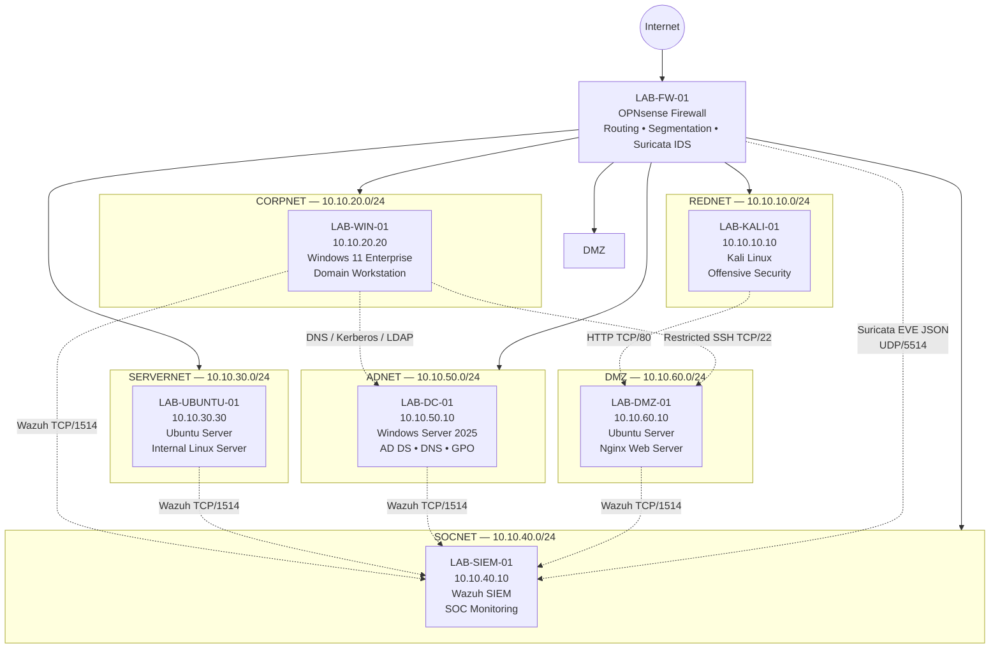

# Cybersecurity Lab Network Diagram

## Overview

The Cybersecurity Home Lab uses a six-zone segmented architecture with OPNsense acting as the central firewall, router, and network security enforcement point.

Each security zone is implemented as a separate Oracle VirtualBox Internal Network.

All inter-zone communication must traverse `LAB-FW-01`, allowing firewall policy, logging, and intrusion detection to be applied between networks.

---

## Logical Network Topology

---

## Network Summary

| Zone | Subnet | Gateway | Primary Host | Purpose |
|---|---|---|---|---|
| REDNET | `10.10.10.0/24` | `10.10.10.1` | `LAB-KALI-01` | Offensive security |
| CORPNET | `10.10.20.0/24` | `10.10.20.1` | `LAB-WIN-01` | Corporate workstation |
| SERVERNET | `10.10.30.0/24` | `10.10.30.1` | `LAB-UBUNTU-01` | Internal Linux services |
| SOCNET | `10.10.40.0/24` | `10.10.40.1` | `LAB-SIEM-01` | SIEM and monitoring |
| ADNET | `10.10.50.0/24` | `10.10.50.1` | `LAB-DC-01` | Active Directory |
| DMZ | `10.10.60.0/24` | `10.10.60.1` | `LAB-DMZ-01` | Externally exposed services |

---

## VirtualBox Network Mapping

`LAB-FW-01` is connected to each VirtualBox Internal Network and provides the gateway for every security zone.

| VirtualBox Network | Security Zone | Subnet |
|---|---|---|
| `RED-NET` | REDNET | `10.10.10.0/24` |
| `CORP-NET` | CORPNET | `10.10.20.0/24` |
| `SERVER-NET` | SERVERNET | `10.10.30.0/24` |
| `SOC-NET` | SOCNET | `10.10.40.0/24` |
| `AD-NET` | ADNET | `10.10.50.0/24` |
| `DMZ-NET` | DMZ | `10.10.60.0/24` |

The OPNsense firewall also maintains an upstream NAT interface for controlled Internet connectivity.

---

## OPNsense Role

`LAB-FW-01` performs several security functions.

### Routing

OPNsense routes traffic between the six internal networks.

No host directly connects multiple internal security zones.

### Firewall Enforcement

All inter-zone traffic crosses OPNsense.

This allows explicit security policies to control:

- source network
- destination network
- protocol
- destination port
- logging
- administrative access

The architecture therefore avoids unrestricted east-west communication.

### Internet Access

Internal systems requiring software updates can reach the Internet through the OPNsense upstream interface.

Internet access is granted according to zone requirements rather than providing unrestricted outbound access everywhere.

### Intrusion Detection

Suricata runs on OPNsense.

The REDNET-facing interface is monitored to provide visibility into attack-simulation traffic.

Suricata events are exported to the SIEM environment for centralized investigation.

---

## Corporate Workstation to Active Directory

    LAB-WIN-01
    10.10.20.20
    CORPNET
         |
         | DNS / Kerberos / LDAP
         v
    LAB-FW-01
         |
         v
    LAB-DC-01
    10.10.50.10
    ADNET

Validated services include:

- DNS TCP/53
- Kerberos TCP/88
- LDAP TCP/389

These services allow the Windows workstation to operate as a member of the `cyberlab.internal` domain.

---

## Endpoint Monitoring Path

    LAB-WIN-01 --------\
    LAB-UBUNTU-01 ------\
    LAB-DC-01 ------------> LAB-SIEM-01
    LAB-DMZ-01 ----------/   10.10.40.10
                             SOCNET

Wazuh agent communication uses:

`TCP/1514`

Enrollment services may use:

`TCP/1515`

Each endpoint is monitored from the centralized Wazuh infrastructure.

---

## Suricata Monitoring Path

    LAB-KALI-01
    10.10.10.10
    REDNET
         |
         | Attack / test traffic
         v
    LAB-FW-01
    OPNsense + Suricata
         |
         | EVE JSON
         v
    Remote Syslog UDP/5514
         |
         v
    LAB-SIEM-01
    10.10.40.10
         |
         v
    /var/log/suricata/eve.json
         |
         v
    Wazuh

This path was validated using a controlled HTTP response containing:

`uid=0(root) gid=0(root) groups=0(root)`

Suricata generated:

- SID `2100498`
- `GPL ATTACK_RESPONSE id check returned root`

Wazuh subsequently generated:

- Rule `86601`

---

## REDNET to DMZ Attack Simulation Path

    LAB-KALI-01
    10.10.10.10
         |
         | HTTP TCP/80
         v
    LAB-FW-01
    Suricata IDS
         |
         v
    LAB-DMZ-01
    10.10.60.10
    Nginx

This is an intentionally approved path used for controlled web-security testing.

Validated behaviour:

- HTTP TCP/80 — Allowed
- SSH TCP/22 — Blocked

REDNET cannot use SSH to administer the DMZ server.

---

## DMZ Administrative Path

DMZ administration is separated from the offensive network.

Approved path:

    LAB-WIN-01
    10.10.20.20
    CORPNET
         |
         | SSH TCP/22
         v
    LAB-FW-01
         |
         v
    LAB-DMZ-01
    10.10.60.10
    DMZ

Only the approved administrative workstation is permitted to use this path.

SSH authentication on `LAB-DMZ-01` is hardened with:

- public-key authentication enabled
- password authentication disabled
- keyboard-interactive authentication disabled
- direct root SSH login disabled

The Domain Controller is not used as a general-purpose jump host.

---

## DMZ Isolation

The DMZ is designed to prevent compromise of the web server from automatically providing access to protected internal systems.

Validated blocked paths include:

    DMZ → CORPNET SMB/445
    DMZ → ADNET LDAP/389

Permitted security-monitoring path:

    DMZ → SOCNET Wazuh TCP/1514

Permitted Internet access includes required HTTP/HTTPS traffic for package management.

---

## REDNET Isolation

REDNET represents the least-trusted internal security zone.

Validated firewall behaviour includes:

    REDNET → DMZ HTTP/80       ALLOW
    REDNET → DMZ SSH/22        BLOCK
    REDNET → CORPNET SMB/445   BLOCK
    REDNET → ADNET LDAP/389    BLOCK

This allows controlled offensive testing without giving the attacker workstation unrestricted access to enterprise services.

---

## SERVERNET Isolation

SERVERNET represents protected internal server infrastructure.

Validated behaviour:

    SERVERNET → SOCNET Wazuh/1514   ALLOW
    SERVERNET → CORPNET SMB/445     BLOCK
    SERVERNET → DMZ SSH/22          BLOCK

---

## ADNET Isolation

ADNET contains the most sensitive identity infrastructure in the environment.

Validated behaviour:

    CORPNET → ADNET required domain services   ALLOW
    ADNET → SOCNET Wazuh/1514                  ALLOW
    REDNET → ADNET LDAP/389                    BLOCK
    ADNET → DMZ SSH/22                         BLOCK

Identity infrastructure is therefore reachable only through explicitly approved communication paths.

---

## SOCNET

SOCNET is the centralized security operations network.

`LAB-SIEM-01` hosts:

- Wazuh Manager
- Wazuh Indexer
- Wazuh Dashboard
- Filebeat
- Suricata event collection

During final validation, all monitored endpoints were active:

    LAB-WIN-01       Active
    LAB-UBUNTU-01    Active
    LAB-DC-01        Active
    LAB-DMZ-01       Active

---

## Monitoring Layers

The lab uses multiple layers of visibility.

### Network Layer

Provided by:

- OPNsense firewall logs
- Suricata IDS

### Endpoint Layer

Provided by:

- Wazuh agents
- Sysmon
- Windows Security logs
- Windows Defender
- Linux auditd

### Identity Layer

Provided by:

- Active Directory events
- Domain Controller auditing
- Group Policy
- Sysmon

### Application Layer

Provided by:

- Nginx access logs
- Nginx error logs

These telemetry sources converge within the SOC environment.

---

## Defense-in-Depth Model

The architecture does not rely on a single security control.

A simulated attack may pass through several detection points:

    Attacker
       |
       v
    Firewall
       |
       v
    Suricata IDS
       |
       v
    Target Service
       |
       v
    Endpoint / Application Logs
       |
       v
    Wazuh SIEM
       |
       v
    SOC Investigation

This provides multiple opportunities to detect, investigate, and respond to suspicious activity.

---

## Final Validated Topology

The completed environment consists of:

                             Internet
                                |
                                |
                         +-------------+
                         |  LAB-FW-01  |
                         |   OPNsense  |
                         +-------------+
                                |
         ---------------------------------------------------------
         |          |           |          |          |          |
         |          |           |          |          |          |
       REDNET     CORPNET    SERVERNET    SOCNET     ADNET       DMZ
     10.10.10    10.10.20    10.10.30   10.10.40   10.10.50   10.10.60
         |          |           |          |          |          |
         |          |           |          |          |          |
       KALI      WINDOWS      UBUNTU      WAZUH       DC       NGINX
       .10         .20          .30        .10        .10        .10

---

## Snapshot Baseline

Following final infrastructure validation and cleanup of obsolete build snapshots, every virtual machine retains the same known-good snapshot name:

`Final-Six-Zone-Validated-Baseline`

The snapshot represents the verified state of the architecture before operational SOC and Purple Team simulations begin.

---

## Architecture Status

The network architecture is considered complete and validated.

Future work should focus on operating and testing the environment rather than adding unnecessary infrastructure.

Planned operational activities include:

- SOC investigations
- Purple Team attack simulations
- Active Directory attack scenarios
- detection engineering
- web attack simulation
- threat hunting
- incident response
- security-control validation
- post-incident reporting
